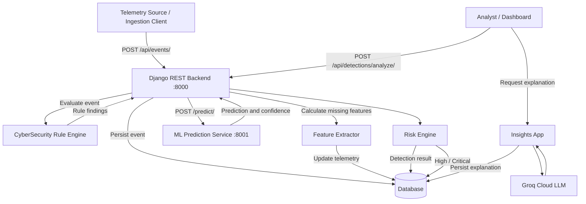

# ThreatLens — AI-Powered Web Attack Detection & Security Analytics Platform

ThreatLens is an AI-assisted web security analytics platform designed to ingest web traffic telemetry, detect potential attacks, evaluate security risks, and provide actionable security insights.

The platform combines three complementary components:

1. **Deterministic rule-based detection:** A Python Standard Library-based engine that evaluates incoming telemetry against predefined web attack detection rules.
2. **Machine learning prediction:** An independent HTTP microservice that evaluates behavioral traffic features and predicts whether an event is malicious or benign.
3. **Centralized backend and AI insights:** A Django REST Framework backend coordinates detection, risk scoring, alert management, and optional incident explanations using Groq Cloud LLMs.

The project follows a modular architecture in which the rule engine and ML service operate independently, while Django coordinates their results and exposes them through REST APIs.

---

## Table of Contents

- [Project Overview](#project-overview)
- [Key Features](#key-features)
- [System Architecture](#system-architecture)
- [Technology Stack](#technology-stack)
- [Project Structure](#project-structure)
- [CyberSecurity Module](#cybersecurity-module)
- [Machine Learning Module](#machine-learning-module)
- [Backend API](#backend-api)
- [Installation and Setup](#installation-and-setup)
- [Testing](#testing)
- [Implementation Status](#implementation-status)
- [Production Readiness and Future Improvements](#production-readiness-and-future-improvements)

---

## Project Overview

Traditional signature-based detection can struggle with unfamiliar attack patterns, while machine-learning predictions can produce false positives and false negatives.

ThreatLens addresses these limitations through a hybrid detection architecture.

### Core components

1. **Rule-based detection (`CyberSecurity`):** Evaluates HTTP telemetry against 30 detection rules across 10 security categories. The engine uses deterministic pattern matching and metadata-based indicators.
2. **Machine learning (`ml`):** Uses a calibrated gradient-boosting classifier to evaluate behavioral features such as request rate, failed login counts, and special-character counts.
3. **Risk synthesis (`backend/security`):** Combines rule-based findings and ML predictions into a final risk score and severity classification.
4. **AI insights (`backend/insights`):** Uses Groq Cloud LLMs to generate human-readable incident explanations, impact assessments, mitigation recommendations, and report summaries when configured.

**Important:** The current ML model is trained and evaluated using synthetic telemetry. Its reported metrics should not be interpreted as validated real-world detection performance.

---

## Key Features

- **JWT Authentication:** Token-based authentication using Django REST Framework SimpleJWT.
- **Custom User Model:** Supports `admin`, `analyst`, and `viewer` role values.
- **Security Event Ingestion:** REST APIs for storing source IP addresses, endpoints, raw payloads, and telemetry features.
- **Automated Feature Extraction:** Calculates special-character counts, recent failed login counts, and request rates during the analysis pipeline when the corresponding input features need to be derived.
- **Rule-Based Attack Detection:** 30 predefined rules covering SQL Injection, XSS, Brute Force, Command Injection, Path Traversal, SSRF, IDOR, Session Security, API Security, and Security Misconfiguration.
- **Independent ML Service:** An HTTP prediction service running separately from Django.
- **Hybrid Risk Scoring:** Combines rule-based severity weights with malicious ML prediction confidence.
- **Severity Floors:** Prevents a confirmed rule-based detection from being downgraded below its configured rule severity.
- **Alert Management:** Creates alerts for high- and critical-severity detections and supports alert status updates.
- **AI Incident Explanations:** Optional LLM-generated explanations and mitigation recommendations.
- **Security Analytics:** Aggregated security statistics and reporting endpoints.
- **Frontend Integration:** JSON REST APIs, pagination, filtering, and configurable CORS.

---

## System Architecture

### Architectural Data Flow



### Component Separation and Coordination

ThreatLens separates the detection engine from the machine-learning service.

**CyberSecurity module**
- Runs in-process within the Django application.
- Uses Python Standard Library functionality.
- Evaluates telemetry through deterministic rules.
- Does not require a separate HTTP service.

**Machine learning service**
- Runs independently through `ml/serve.py`.
- Exposes an HTTP prediction endpoint on port `8001`.
- Loads the trained model and its data-science dependencies.
- Returns a prediction and confidence value.

**Django backend**

The backend coordinates the workflow:

1. Retrieves the stored security event.
2. Transforms event data into the format expected by the CyberSecurity adapter.
3. Executes the rule-based detection engine.
4. Enriches telemetry features when required.
5. Sends the feature vector to the ML service.
6. Combines the results through the risk engine.
7. Stores the detection result.
8. Creates an alert when the final severity meets the configured alert threshold.

AI explanations are generated through a separate, on-demand workflow.

### Detection and Risk Scoring Pipeline

The risk engine combines rule severity and ML prediction confidence.

The current scoring model is:

\[
\text{Risk Score} =
\left(0.5S_{\text{rule}}+0.5C_{\text{ml}}\right)\times100
\]

Where:

**Rule score**

The rule engine does not treat its deterministic findings as calibrated probabilities. Instead, the backend maps rule severity to a configured weight:

| Rule severity | Rule weight |
|---|---:|
| Low | 0.25 |
| Medium | 0.50 |
| High | 0.80 |
| Critical | 1.00 |
| No rule detected | 0.00 |

**ML score**

- When the ML service predicts `malicious`, the malicious-class probability is used.
- When the prediction is `benign`, the malicious score is set to zero.
- When the service is unavailable or returns an invalid result, the backend uses its configured fallback behavior.

**Risk classification**

| Risk score | Base severity |
|---|---|
| 85–100 | Critical |
| 65–84.99 | High |
| 40–64.99 | Medium |
| Below 40 | Low |

**Deterministic severity floor**

The final severity also considers the severity of a confirmed rule-based finding. A confirmed high- or critical-severity rule can therefore produce a final severity higher than the score-only classification.

This is intended to prevent a benign or unavailable ML prediction from suppressing a serious rule-based finding.

---

## Technology Stack

| Layer | Technology | Purpose |
|---|---|---|
| Backend | Python, Django 5.2.17 | Application backend and workflow coordination |
| REST APIs | Django REST Framework | API endpoints and serialization |
| Authentication | SimpleJWT | JWT authentication |
| Database | PostgreSQL / configured Django database | Persistent storage |
| CORS | django-cors-headers | Cross-origin frontend communication |
| Detection | Python Standard Library | Rule-based attack detection |
| Machine Learning | scikit-learn | Classification and probability calibration |
| Data Processing | NumPy, pandas | Dataset generation and feature handling |
| Model Persistence | joblib | Saving and loading the trained model |
| ML Service | Python `http.server` | Standalone prediction endpoint |
| AI Integration | Groq Cloud API | Incident explanations and reporting |
| HTTP Client | Requests | Backend-to-service communication |
| Frontend | External / planned | Decoupled dashboard consuming REST APIs |

The ML dependency versions should be kept compatible with the serialized model artifact. The documented scikit-learn pin is `1.7.2`; verify the committed model loads successfully with that version before treating the installation as reproducible.

---

## Project Structure

```text
ThreatLens/
│
├── README.md
├── requirements.txt
│
├── CyberSecurity/
│   ├── Detection/
│   │   ├── engine.py
│   │   ├── sqli.py
│   │   ├── xss.py
│   │   ├── brute_force.py
│   │   ├── command_injection.py
│   │   ├── path_traversal.py
│   │   ├── ssrf.py
│   │   ├── idor.py
│   │   ├── session_security.py
│   │   ├── api_security.py
│   │   └── security_misconfiguration.py
│   │
│   ├── Integration/
│   │   ├── adapter.py
│   │   ├── schemas.py
│   │   ├── serializers.py
│   │   └── exceptions.py
│   │
│   ├── Docs/
│   ├── Tests/
│   └── requirements.txt
│
├── backend/
│   ├── manage.py
│   ├── .env.example
│   ├── requirements.txt
│   ├── mock_ml.py
│   │
│   ├── config/
│   │   ├── settings.py
│   │   ├── urls.py
│   │   └── pagination.py
│   │
│   ├── accounts/
│   │   ├── models.py
│   │   ├── serializers.py
│   │   ├── views.py
│   │   └── urls.py
│   │
│   ├── security/
│   │   ├── models.py
│   │   ├── feature_extractor.py
│   │   ├── ml_client.py
│   │   ├── rule_client.py
│   │   ├── risk_engine.py
│   │   ├── serializers.py
│   │   ├── views.py
│   │   ├── tests.py
│   │   └── test_ml_client.py
│   │
│   └── insights/
│       ├── models.py
│       ├── llm_client.py
│       ├── report_service.py
│       ├── serializers.py
│       ├── views.py
│       └── urls.py
│
└── ml/
    ├── README.md
    ├── generate_dataset.py
    ├── train.py
    ├── serve.py
    ├── requirements.txt
    ├── metrics.json
    ├── threatlens_model.joblib
    └── data/
        └── telemetry.csv
```

---

## CyberSecurity Module

### Rule-Based Detection Engine

The `CyberSecurity` module is the deterministic detection component of ThreatLens.

Its main characteristics are:

- Uses Python Standard Library functionality.
- Evaluates incoming event data using predefined detection rules.
- Returns structured detection findings and supporting evidence.
- Keeps rule-based detection independent of the external ML prediction service.
- Reports rule confidence as `0.0` rather than presenting deterministic matches as calibrated probabilities.

### Detection Categories and Rule Catalog

The documented rule inventory contains 30 rules across 10 security categories.

| Category | Rule IDs | Primary detection objective |
|---|---|---|
| SQL Injection | SQLI-001 to SQLI-004 | Suspicious SQL keywords, Boolean manipulation, comments, UNION queries |
| Cross-Site Scripting | XSS-001 to XSS-003 | Script tags, event handlers, JavaScript URIs |
| Brute Force | BRUTE-001 | Repeated failed authentication attempts |
| Command Injection | CMDI-001 to CMDI-003 | Shell chaining, command substitution, reconnaissance commands |
| Path Traversal | PTRAV-001 to PTRAV-003 | Directory traversal and sensitive file access |
| SSRF | SSRF-001 to SSRF-003 | Requests targeting local, private, or metadata addresses |
| IDOR | IDOR-001 to IDOR-002 | Authorization and object-ownership indicators |
| Session Security | SESSION-001 to SESSION-002 | Session reuse and post-logout activity indicators |
| API Security | API-001 to API-003 | API key and gateway security indicators |
| Security Misconfiguration | MISCONFIG-001 to MISCONFIG-006 | Missing security headers, insecure cookies, and stack traces |

The exact rule behavior and mappings should be maintained in the `CyberSecurity/Docs/` specifications and corresponding detector implementations.

### Django Integration and Adapter Contract

The Django backend integrates the rule engine through an adapter boundary.

1. `backend/config/settings.py` adds the `CyberSecurity` directory to Python's import path.
2. `backend/security/rule_client.py` transforms a stored security event into the normalized input format.
3. `CyberSecurity/Integration/adapter.py` calls `evaluate_for_backend()`.
4. The adapter returns a structured result for the Django backend.

Example output:

```json
{
  "event_id": 101,
  "rule_detected": true,
  "rule_confidence": 0.0,
  "attack_type": "SQL Injection",
  "evidence": "[SQLI-001] Suspicious SQL keyword combination",
  "severity": "high"
}
```

The actual evidence and attack classification depend on the matched rules.

---

## Machine Learning Module

### Training and Model Calibration

The ML training pipeline is implemented in `ml/train.py`.

The documented training workflow includes:

1. Comparing candidate classification models.
2. Evaluating candidate models using stratified cross-validation.
3. Selecting a gradient-boosting classifier.
4. Applying isotonic probability calibration.
5. Saving the trained model and feature schema using joblib.

The selected model is a HistGradientBoosting classifier wrapped with `CalibratedClassifierCV`.

Calibration is intended to make the predicted probabilities more suitable for use by the backend risk engine. It does not guarantee accurate probabilities on real-world traffic without external validation.

### Dataset Generation

The project uses `ml/generate_dataset.py` to generate synthetic telemetry.

The documented dataset contains 20,000 labelled records.

Input features:

| Feature | Description |
|---|---|
| `request_rate` | Requests per second |
| `failed_logins` | Failed login count within the observation window |
| `special_characters` | Count of special characters in payload values |

The generated dataset includes simulated benign and malicious traffic patterns, including:

- Normal browsing and bursty sessions.
- Authentication failures.
- Injection-like payload patterns.
- High request-rate activity.
- Mixed scanning behavior.

The dataset also introduces synthetic noise to avoid an entirely deterministic training dataset.

**Dataset limitation:** Synthetic samples are useful for development and pipeline testing, but they cannot establish the model's real-world generalization. Evaluation using representative, independently labelled production or benchmark traffic remains future work.

### Prediction Microservice

The ML service is implemented in `ml/serve.py`.

It:

- Runs as a separate Python HTTP service.
- Exposes the `/predict/` endpoint.
- Accepts a JSON feature vector.
- Loads the serialized classifier.
- Returns a prediction and confidence value.

Default local endpoint:

`http://127.0.0.1:8001/predict/`

### Prediction Request

```http
POST /predict/
Content-Type: application/json
```

```json
{
  "request_rate": 45.2,
  "failed_logins": 8,
  "special_characters": 14
}
```

### Prediction Response

```json
{
  "prediction": "malicious",
  "confidence": 0.9412
}
```

The confidence field represents the model's selected prediction confidence according to the service's response contract. It is not a statistical confidence interval.

### Documented Model Evaluation

The following figures are documented in the project's model evaluation results. They relate to the synthetic dataset and its held-out evaluation split.

| Metric | Documented result |
|---|---:|
| Selected model | HistGradientBoosting |
| 5-fold CV PR-AUC | 0.9293 ± 0.0039 |
| Test ROC-AUC | 0.9517 |
| Test PR-AUC | 0.9242 |
| Test accuracy | 91.35% |
| Benign F1 | 0.9331 |
| Malicious F1 | 0.8777 |

Refer to `ml/metrics.json` for the stored evaluation results.

These values should not be presented as production detection accuracy. Real-world performance requires testing against representative traffic that was not used to generate or train the synthetic dataset.

---

## Backend API

The Django backend exposes REST endpoints for authentication, telemetry ingestion, detection, alert management, and AI-assisted reporting.

### Authentication and Access Control

ThreatLens uses SimpleJWT.

Protected requests require:

```http
Authorization: Bearer <access_token>
```

The custom user model supports the role values:

- `admin`
- `analyst`
- `viewer`

Public registration accepts `username`, `email`, and `password`. Newly registered users receive the default `viewer` role. The public registration endpoint does not allow clients to assign themselves elevated roles.

Protected endpoints use the configured authentication and permission settings. Role-specific authorization should be verified separately for each endpoint before describing the entire application as having fully enforced RBAC.

### Pagination

List endpoints use `StandardPagination`.

Documented configuration:

- Default page size: 20.
- Maximum page size: 100.
- Page navigation through `?page=N`.
- Optional page-size selection through `?page_size=N`.

Example response:

```json
{
  "count": 42,
  "next": "http://127.0.0.1:8000/api/detections/?page=2",
  "previous": null,
  "results": []
}
```

Frontend applications should read records from the `results` property rather than treating the complete response as an array.

### Endpoint Catalog

| Method | Endpoint | Purpose | Authentication |
|---|---|---|---|
| POST | `/api/auth/register/` | Register a user | No |
| POST | `/api/auth/login/` | Obtain JWT tokens | No |
| POST | `/api/auth/refresh/` | Refresh an access token | No |
| POST | `/api/events/` | Ingest a security event | Yes |
| GET | `/api/events/list/` | List security events | Yes |
| POST | `/api/detections/analyze/` | Analyze an event | Yes |
| GET | `/api/detections/` | List detection results | Yes |
| GET | `/api/alerts/` | List security alerts | Yes |
| PUT / PATCH | `/api/alerts/<int:pk>/` | Update an alert | Yes |
| POST | `/api/scans/` | Create a scan record | Yes |
| GET | `/api/scans/<int:pk>/` | Retrieve a scan | Yes |
| POST | `/api/ai/explain/<int:detection_id>/` | Generate an AI explanation | Yes |
| GET | `/api/ai/explain/<int:detection_id>/` | Retrieve an explanation | Yes |
| GET | `/api/reports/summary/` | Generate security statistics | Yes |
| POST | `/api/reports/ai-summary/` | Generate an AI report summary | Yes |
| GET | `/api/reports/` | List reports | Yes |

The Django administrative interface is available at `/admin/` and requires appropriate staff or superuser access.

### Sample Workflow

**1. Register a user**

```http
POST /api/auth/register/
Content-Type: application/json
```

```json
{
  "username": "security_analyst",
  "email": "analyst@example.com",
  "password": "A-Strong-Unique-Password!123"
}
```

The public registration flow assigns the default `viewer` role.

**2. Log in**

```http
POST /api/auth/login/
Content-Type: application/json
```

```json
{
  "username": "security_analyst",
  "password": "A-Strong-Unique-Password!123"
}
```

Use the returned access token for protected API requests.

**3. Ingest a security event**

```http
POST /api/events/
Authorization: Bearer <ACCESS_TOKEN>
Content-Type: application/json
```

```json
{
  "source_ip": "198.51.100.42",
  "endpoint": "/api/v1/search",
  "raw_payload": {
    "method": "POST",
    "query": "test",
    "body": {
      "input": "' UNION SELECT username, password FROM users --"
    }
  }
}
```

**4. Analyze the event**

```http
POST /api/detections/analyze/
Authorization: Bearer <ACCESS_TOKEN>
Content-Type: application/json
```

```json
{
  "event_id": 1
}
```

The backend performs rule evaluation, feature enrichment, ML prediction, risk synthesis, and detection persistence.

**5. Request an AI explanation**

```http
POST /api/ai/explain/1/
Authorization: Bearer <ACCESS_TOKEN>
```

This operation requires a valid Groq API key and a working LLM configuration.

AI explanations are generated on demand rather than being required for the core detection pipeline.

---

## Installation and Setup

The following instructions describe a local Windows development setup using PowerShell.

### Prerequisites

- Python 3.10 or higher.
- Git.
- PostgreSQL if using the project's PostgreSQL configuration.
- A Groq Cloud API key for AI explanations and AI report generation.
- Compatible ML dependencies as specified in `ml/requirements.txt`.

### Step 1: Clone the repository

```powershell
git clone https://github.com/GAURAVPARETA555/Threatlens.git
Set-Location Threatlens
```

### Step 2: Create and activate a virtual environment

```powershell
python -m venv env
.\env\Scripts\Activate.ps1
```

### Step 3: Install dependencies

```powershell
pip install -r backend/requirements.txt
pip install -r ml/requirements.txt
```

The backend and ML requirements are maintained separately because the ML service uses additional data-science dependencies.

### Step 4: Configure environment variables

Create the backend environment file:

```powershell
Copy-Item backend\.env.example backend\.env
```

Edit `backend\.env` and configure the values required by `backend/config/settings.py` and the relevant application services.

At minimum, review:

- Django secret key.
- Debug setting.
- Allowed hosts.
- Database configuration.
- ML service URL.
- Groq API key.
- Groq model and API URL.
- CORS allowed origins.
- CSRF trusted origins.

Example service values:

```env
ML_SERVICE_URL=http://127.0.0.1:8001/predict/

GROQ_API_KEY=your_actual_groq_api_key
GROQ_CHAT_MODEL=openai/gpt-oss-120b
LLM_API_URL=https://api.groq.com/openai/v1/chat/completions

CORS_ALLOWED_ORIGINS=http://localhost:5173,http://127.0.0.1:5173
CSRF_TRUSTED_ORIGINS=http://localhost:5173,http://127.0.0.1:5173
```

Use the actual environment variable names supported by the checked-out version of the backend settings and `.env.example`. If your frontend uses a different origin or port, update the CORS and CSRF configuration accordingly.

**Security warning:** Never commit `backend/.env`, real API keys, database passwords, or production secrets to Git.

### Step 5: Database setup

Configure the database according to the database settings supported by the checked-out backend version.

For PostgreSQL, ensure the database server is running and the configured database and user exist.

Then run:

```powershell
python backend/manage.py migrate
python backend/manage.py createsuperuser
```

### Step 6: Start the ML service

Open the first PowerShell terminal from the repository root:

```powershell
.\env\Scripts\Activate.ps1
python ml/serve.py
```

The service should listen on:

`http://127.0.0.1:8001/predict/`

Keep this terminal running.

### Step 7: Start the Django backend

Open a second PowerShell terminal from the repository root:

```powershell
.\env\Scripts\Activate.ps1
python backend/manage.py runserver 127.0.0.1:8000
```

The backend should be available at:

`http://127.0.0.1:8000/`

Both services must be running for the complete live detection pipeline. The backend is designed to handle ML service failures through its configured fallback behavior.

### Frontend Integration

The current repository is documented as a headless, API-first backend; a dedicated frontend application is not bundled in this repository.

A frontend can integrate through the REST API:

1. Register or log in.
2. Store and use the returned JWT access token securely.
3. Send authenticated requests with the Bearer token.
4. Submit telemetry events.
5. Request event analysis.
6. Display detections, alerts, and reports.
7. Request AI explanations when needed.

CORS must allow the frontend's actual origin. For the local Vite development origin tested with this backend, that is:

`http://localhost:5173`

---

## Testing

ThreatLens contains separate test suites for the CyberSecurity rule engine and Django backend integration.

### CyberSecurity Test Suite

The CyberSecurity module has a documented suite of 131 unit and regression tests.

Run from the repository root:

```powershell
python -m unittest discover -s CyberSecurity/Tests -p "Test_*.py" -t CyberSecurity
```

Expected outcome: the test runner should report the discovered tests and finish with `OK`.

### Django Backend Test Suite

The documented backend integration tests cover:

- Detection analysis pipeline.
- Detection and event database relationships.
- Alert creation.
- Client-supplied rule-result protection.
- ML client response handling.
- ML service failure and fallback behavior.

Run from the repository root:

```powershell
python backend/manage.py test security
```

The previously verified backend suite contained 23 tests:

- 7 detection pipeline tests.
- 16 ML client resilience tests.

Run the test suite again after making changes. Do not treat the expected result below as proof that a new checkout or later code revision has passed:

```text
Found 23 test(s).
Ran 23 tests
OK
```

### Documented Test Coverage

| Test suite | Test count | Coverage |
|---|---:|---|
| CyberSecurity module | 131 | Rule detection and integration tests |
| Backend detection pipeline | 7 | Event analysis, detection persistence, alert creation |
| Backend ML client | 16 | Timeouts, HTTP failures, invalid responses, fallback behavior |
| **Documented total** | **154** | **Combined test inventory** |

The 154 figure is the sum of the two documented suites. It should be described as passing only when both suites have been executed successfully against the same project revision.

Manual Postman checks have also exercised event ingestion, detection analysis, alerts, ML prediction, and ML-unavailable fallback behavior. These manual checks are separate from automated test counts.

---

## Implementation Status

### Implemented Capabilities

- [x] Custom Django user model with role values.
- [x] JWT authentication and token refresh endpoints.
- [x] Security event ingestion API.
- [x] CyberSecurity rule-engine integration.
- [x] Feature enrichment during the analysis pipeline.
- [x] Independent ML prediction microservice.
- [x] Backend-to-ML HTTP integration.
- [x] ML client fallback behavior for service failures.
- [x] Hybrid risk scoring.
- [x] Detection result persistence.
- [x] High- and critical-severity alert creation.
- [x] Alert listing and lifecycle update endpoints.
- [x] Paginated API responses.
- [x] Configurable CORS for frontend integration.
- [x] Groq-based AI insight integration in the backend codebase.

The implementation checklist describes code-level capabilities. Individual features should still be tested in the deployed environment with the required services and credentials.

### Production Readiness Work

- [ ] Evaluate the ML model against real-world labelled web traffic.
- [ ] Establish a reproducible model compatibility and loading check.
- [ ] Introduce distributed state for brute-force and request-rate tracking.
- [ ] Add endpoint-specific role and object-level authorization checks.
- [ ] Add and test authentication and API rate limiting.
- [ ] Redact sensitive credentials and tokens from stored telemetry and logs.
- [ ] Containerize the backend, ML service, and database.
- [ ] Deploy Django using a production application server.
- [ ] Add health checks, monitoring, and structured operational logging.
- [ ] Validate CORS, CSRF, HTTPS, secret management, and production settings.
- [ ] Benchmark rule-engine and end-to-end pipeline performance.

### Future Roadmap

- [ ] Build a React or Next.js security dashboard.
- [ ] Add interactive threat analytics and alert triage.
- [ ] Integrate active scanning tools such as OWASP ZAP or Nuclei.
- [ ] Introduce asynchronous processing with Celery.
- [ ] Add real-time notifications through email, webhooks, or messaging platforms.
- [ ] Explore sequence-based ML models for multi-request attack behavior.
- [ ] Improve model evaluation using representative external datasets.

---

## Project Objective

The primary objective of ThreatLens is to demonstrate how deterministic cybersecurity rules, machine-learning predictions, and LLM-generated explanations can work together in a modular security analytics platform.

Rather than relying on a single detection method, ThreatLens combines interpretable rule-based findings with behavioral ML predictions, coordinates them through a centralized backend, and presents the resulting security information through structured APIs.

The long-term goal is to evolve the project into a more robust, measurable, and deployable security analytics platform through real-world validation, stronger authorization, distributed processing, and an interactive frontend.
